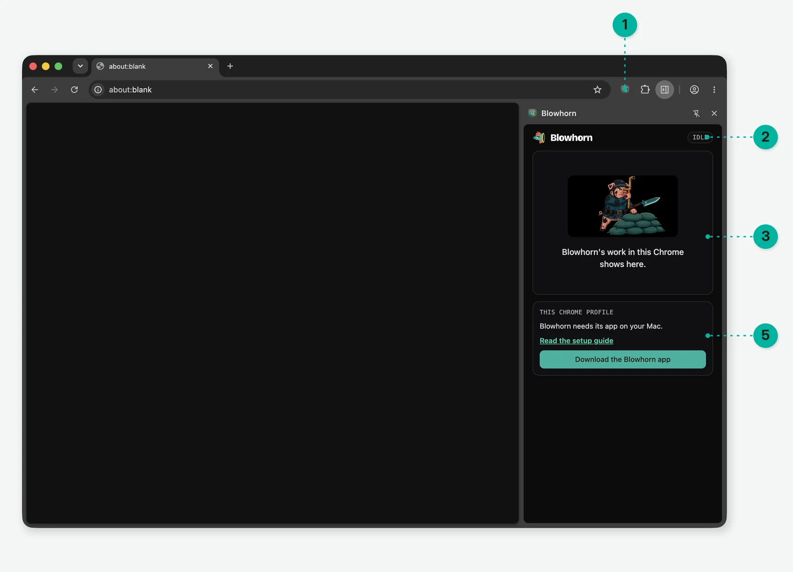
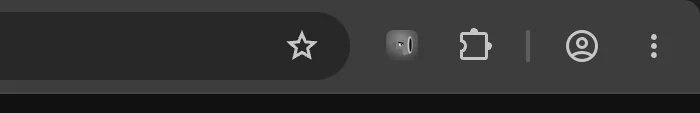
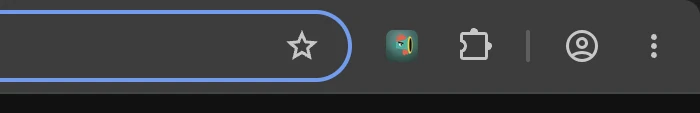
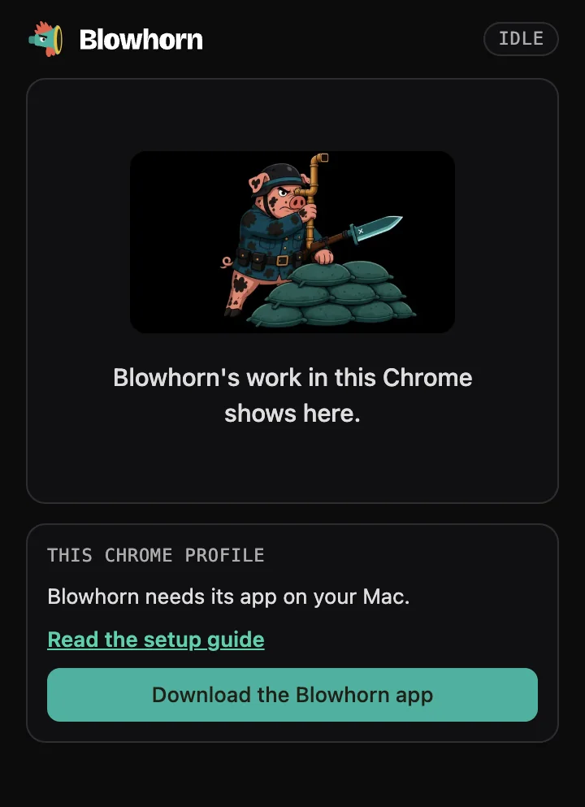

# The Chrome extension, at a glance

> What the Blowhorn side panel is for, how its layout is arranged, and links to install, permissions, and troubleshooting.

The Blowhorn extension is how Blowhorn works in your Google Chrome. It opens as
a side panel on the right of the window. It shows what Blowhorn is doing in this
Chrome and gives you the controls to pause, stop, or take over. It does not add
anything to the pages themselves.

Install and setup are in [Install the Chrome extension](/docs/how-to/set-up/install-the-chrome-extension/).
What the extension may do is in [Chrome extension permissions](/docs/reference/extension-permissions/).
If the panel cannot reach the app, see [Fix the Chrome extension connection](/docs/how-to/troubleshoot/extension-connection/).

## At a glance

Click the Blowhorn button in Chrome's toolbar to open the side panel. If you do
not see the button, open the Extensions menu (the puzzle piece) and pin Blowhorn.

<figure class="docs-figure">
  
  <figcaption>The side panel, docked on the right of a Chrome window. Numbers match the list below. Shown with the Blowhorn app not connected yet, so the toolbar button is grey and the profile section asks you to install the app.</figcaption>
</figure>

- **1. The toolbar button.** Opens and closes the side panel. When Blowhorn needs you, the button shows **!**.
- **2. The status pill.** **Idle** when nothing is running. During a run it reads **Working**, **Paused**, **Needs you**, **You have control**, **Stopped**, or **Ended**.
- **3. The run area.** When Blowhorn is idle, it says "Blowhorn's work in this Chrome shows here." During a run it lists the task, the site, and each step. It never shows what was typed.
- **4. Run controls.** These appear during a run, so they are not in this figure: **Pause** and **Resume**, **Stop**, **Take over** and **Give back**, and **Show me**. How to use them is in [Watch, pause or take over a run in Chrome](/docs/how-to/manage/watch-and-take-over-a-run/).
- **5. This Chrome profile.** Whether this Chrome profile is linked and ready. Here it reads "Blowhorn needs its app on your Mac," with a setup guide link and **Download the Blowhorn app**. When the app is connected, this section tells you whether the profile is ready, or asks you to map it.

## The toolbar button

<figure class="docs-figure">
  
  <figcaption>The Blowhorn button in Chrome's toolbar, to the left of the Extensions puzzle piece. It is grey while the app is not connected.</figcaption>
</figure>

<figure class="docs-figure">
  
  <figcaption>The Blowhorn button in Chrome's toolbar, to the left of the Extensions puzzle piece. While the app is connected, it shows the full-color icon: a rounded teal square with an orange crest and a yellow-and-black horn.</figcaption>
</figure>

## The side panel when idle

<figure class="docs-figure docs-figure--narrow">
  
  <figcaption>The side panel when nothing is running, and the Blowhorn app is not connected yet.</figcaption>
</figure>

## Related

- [Install the Chrome extension](/docs/how-to/set-up/install-the-chrome-extension/) - add it in each Chrome profile you post from.
- [Watch, pause or take over a run in Chrome](/docs/how-to/manage/watch-and-take-over-a-run/) - the controls that appear during a run.
- [Chrome extension permissions](/docs/reference/extension-permissions/) - what the extension may do.
- [Fix the Chrome extension connection](/docs/how-to/troubleshoot/extension-connection/) - when the panel cannot reach the app.
- [Map Blowhorn profiles to Chrome profiles](/docs/how-to/set-up/map-chrome-profiles/) - link a Chrome profile in the app.
- [The Blowhorn app, screen by screen](/docs/reference/use-the-desktop-app/) - the desktop app that the extension talks to.
- [Chrome reference](/docs/reference/chrome/) - launch modes and the extension default.

