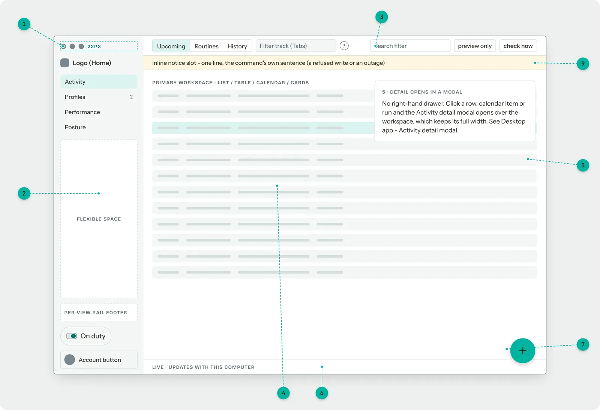
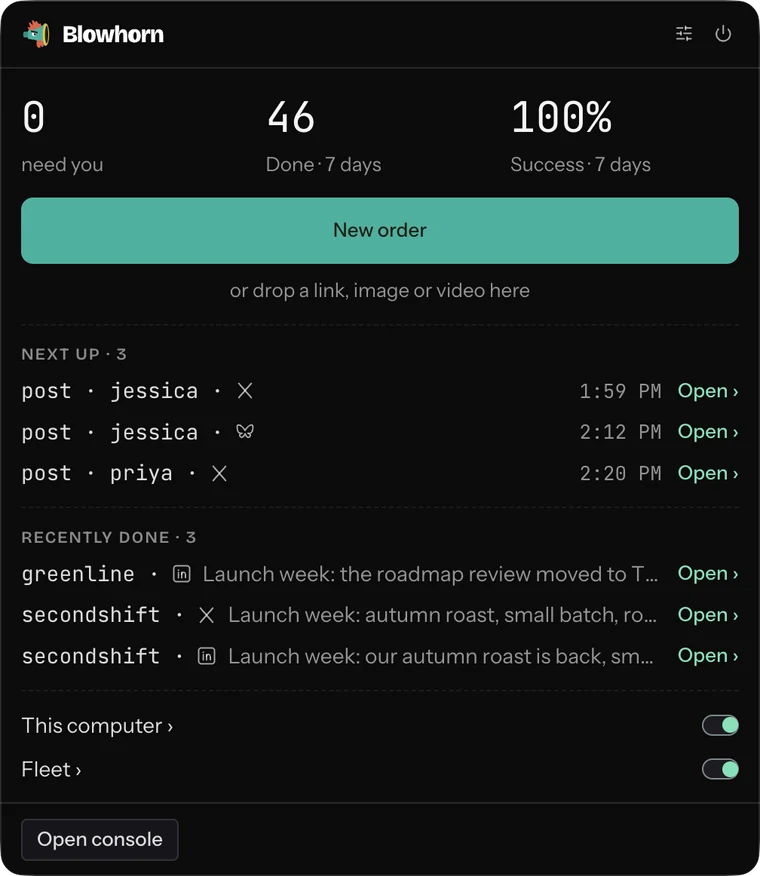
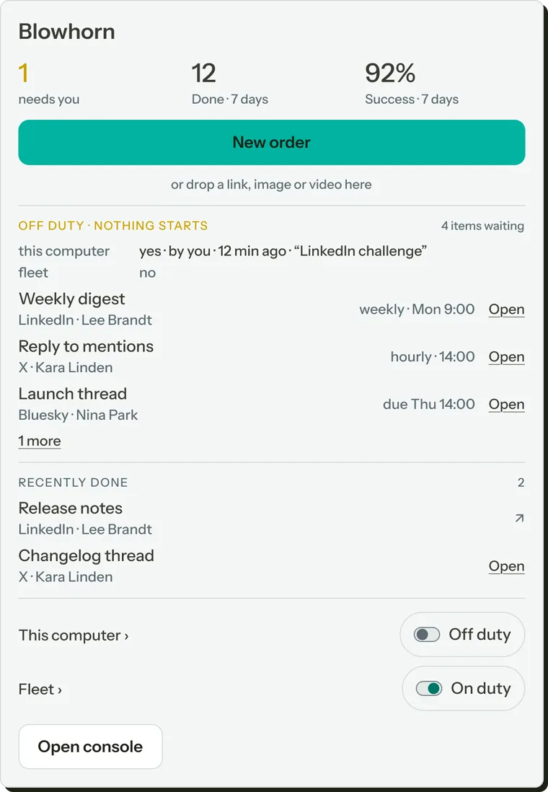
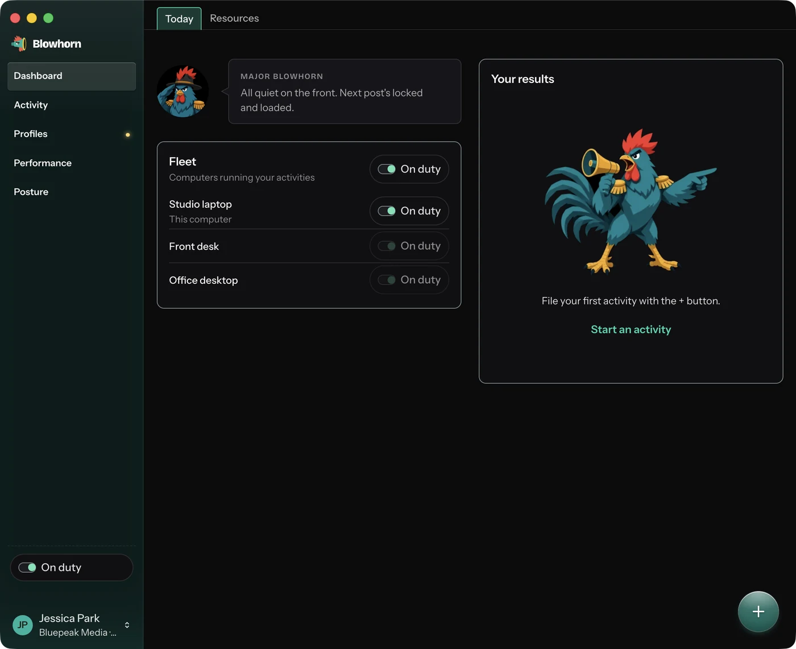
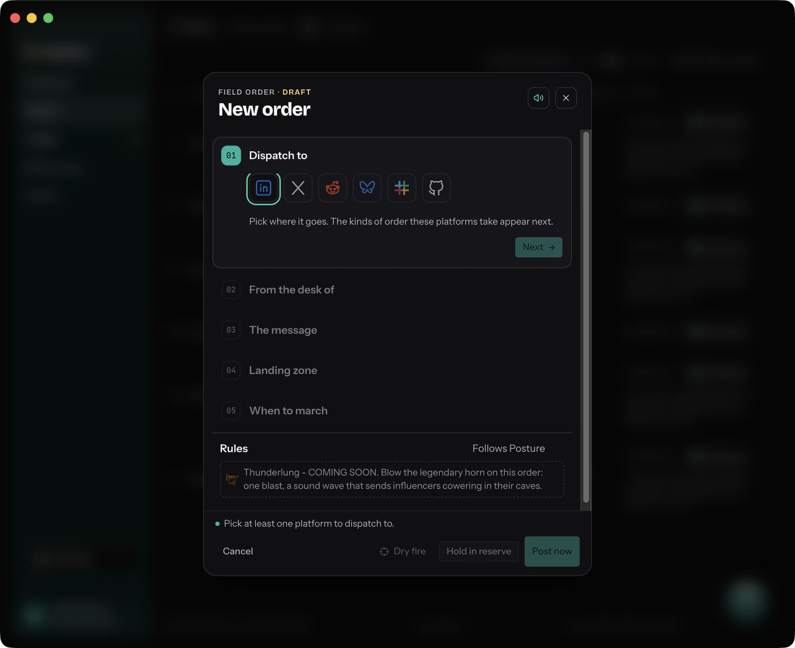
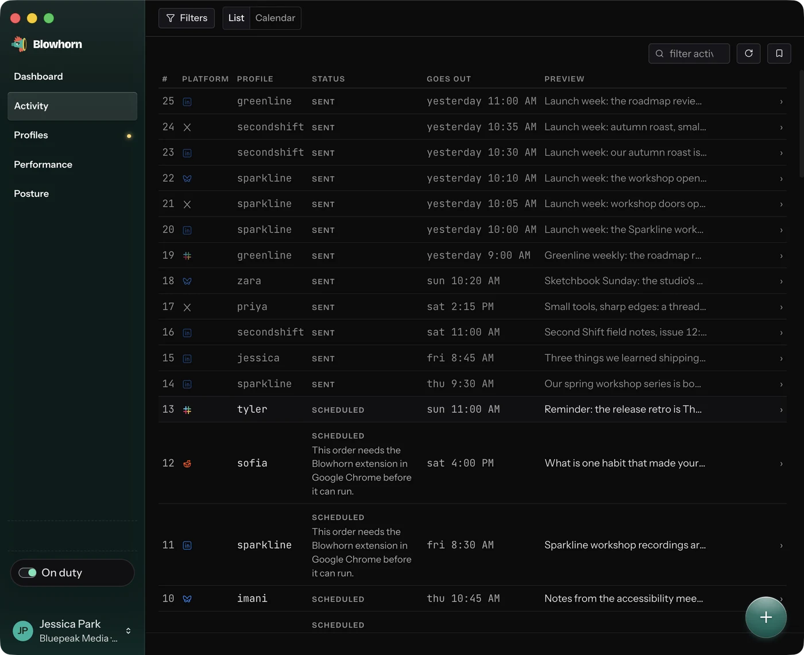
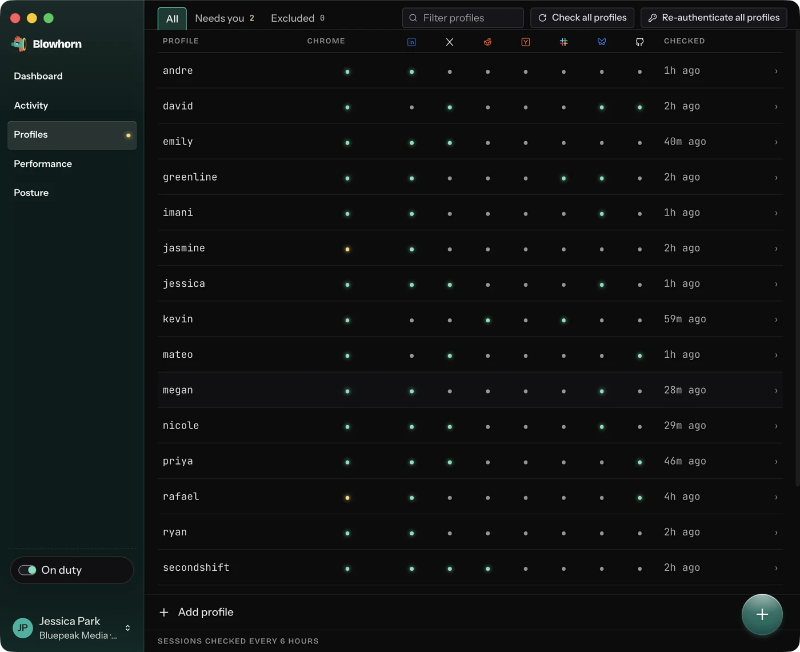
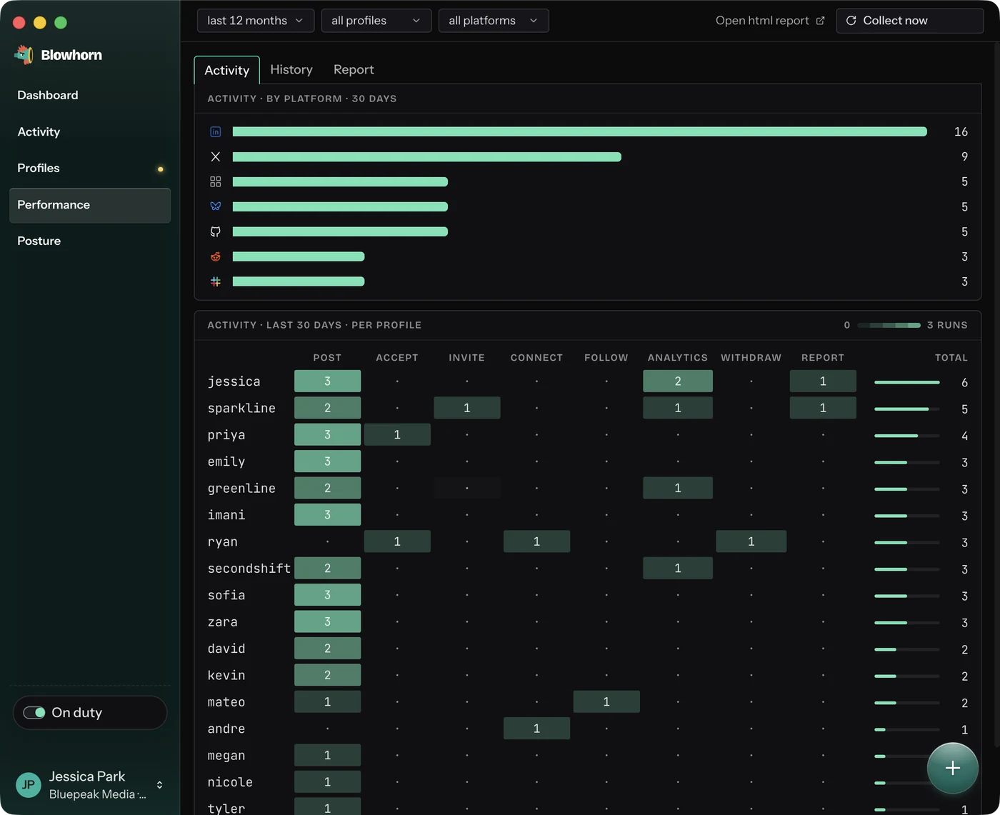
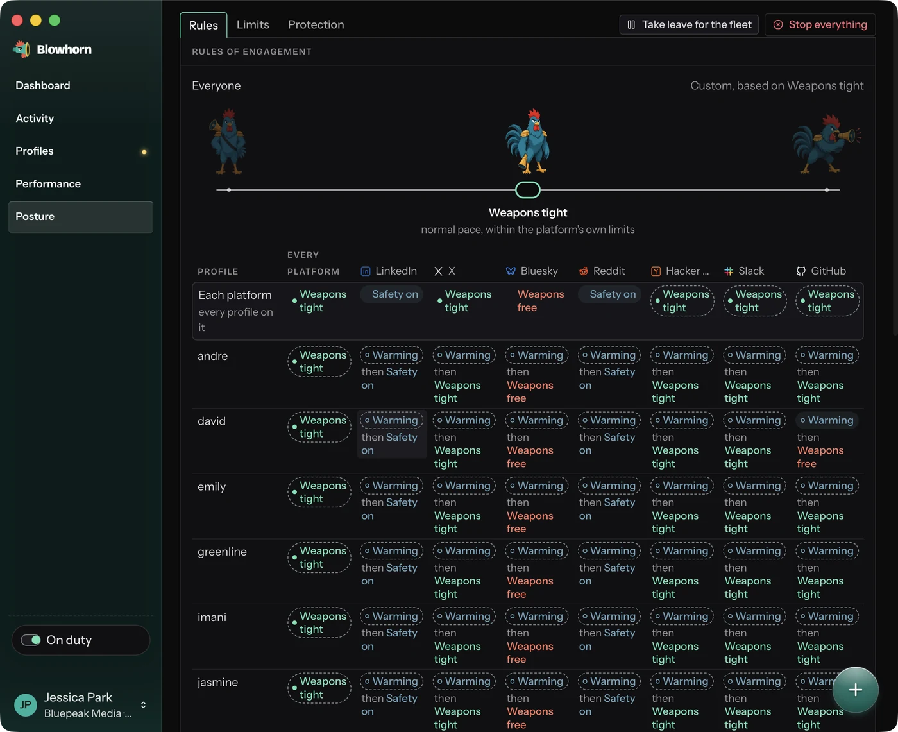

# The Blowhorn app, screen by screen

> The menu-bar popover, the console screens, Setup, Settings, and what each one does.

What each part of the Blowhorn desktop app shows and does. For step-by-step
tasks, follow the how-to guides under [Related](#related).

## The app at a glance

The app has two parts: a small popover that opens from the Blowhorn icon in the
menu bar, and a full window called the console. The sketch below numbers the
console's main areas.

<figure class="docs-figure">
  
  <figcaption>The console layout, from the Blowhorn design file. The app may differ in small details.</figcaption>
</figure>

- **1. Window controls.** Close, hide and resize, as in any Mac app.
- **2. The rail.** The column on the left: the places you can go, this computer's
  duty switch and your account button.
- **3. The screen toolbar.** The screen's tabs, filters and search.
- **4. The main area.** The screen's list, table, calendar or cards.
- **5. Details window.** Clicking a row opens its details over the screen.
- **6. The footer.** A status line at the bottom of some screens.
- **7. The New order button.** The round **+** in the lower right of every
  screen.
- **8. The dimmed layer.** The screen dims behind an open window, such as New
  order. It is not drawn in the sketch.
- **9. The notice line.** Appears under the toolbar only when something needs
  you, such as an outage.

## The menu bar and the popover

<figure class="docs-figure docs-figure--narrow">
  
  <figcaption>The popover, opened from the Blowhorn icon in the menu bar. Shown with demo data.</figcaption>
</figure>

From top to bottom, the popover shows:

- **The header:** a `?` that says what the popover is for, **Settings** and
  **Quit**.
- **The scheduler line:** **Working now** while a check runs, or **Last check**
  and when it finished.
- **Three stats:** items that need you, runs in the last seven days, and the
  success share for that week. A dash means no runs or no reading.
- **New order**, or **New activity** when Major Blowhorn is off in Settings.
- **NEXT UP:** the next three due items. **open ›** opens one in Activity.
- **RECENTLY DONE:** the three newest posts from the last seven days. **↗**
  opens a post's proof link in Google Chrome.
- **Duty:** the **This computer** and **Fleet** switches. Each name opens its
  screen.
- **Open console**, and an update card when a new version is ready.

A notice line appears under the header when something needs you, such as an
outage. To stop everything, use the [Posture](#posture) screen or
`blowhorn stop --all`.

<figure class="docs-figure docs-figure--narrow">
  
  <figcaption>Off duty, the <strong>OFF DUTY</strong> board replaces <strong>NEXT UP</strong>. From the design file.</figcaption>
</figure>

While this computer is off duty, the **OFF DUTY** board replaces NEXT UP. It
says what holds this computer (its own switch, the fleet, quiet hours or a
stop) and lists the first waiting items. NEXT UP comes back when you go on
duty again.

### Drop a link, image or video

Drop something on the popover to start from it:

- **A link to a post or comment** on LinkedIn, X, Reddit, Bluesky, Slack or
  GitHub opens the engage sheet. It offers only the verbs that platform takes:
  Respond, Amplify or both. Only profiles with an active account on that
  platform are offered.
- **Any other link,** such as a Hacker News item, starts a new order from the
  page's title and summary.
- **An image or video** starts a new order.
- **Anything else** is refused with "Links, images or video only".

Respond or Amplify writes an approved item, due now, for each profile you pick.
**Undo** stays available for 10 seconds.

**New order** reads the page in front from the Blowhorn extension in Google
Chrome. An open post opens the engage sheet, and any other page starts a new
order from that page. Without the extension, New order still opens, and any
kind that needs the extension says so with **Install the extension** and **Try
again**.

When an update is ready, **Update** on the popover's update card installs it
and relaunches the app. See [Update Blowhorn](/docs/how-to/manage/update-blowhorn/).

## The console

<figure class="docs-figure">
  
  <figcaption>The console on Home, with the rail on the left. Shown with demo data.</figcaption>
</figure>

The console is the full window. Open it from the popover. The rail lists five
places:

- **Dashboard**, which opens Home.
- **Activity**
- **Profiles**
- **Performance**
- **Posture**

Each screen reads live state when it opens. Until you are signed in and the
extension is ready, every place but Home is locked. See
[Set up Blowhorn at first muster](/docs/how-to/set-up/first-muster-setup/).

### The duty switch

The switch at the bottom of the rail covers this computer only: **On duty** or
**Off duty**. Press it, or press ⌘⇧P, to change it. Hover it to see the next
scheduled run.

If the background service is not running, a line with a red light appears above
the switch: **Blowhorn service is not running on this computer**. Nothing
scheduled goes out until the service runs again. Click the line to open
[This computer](#this-computer), which says why and offers the fix. To take
every computer off duty, see [Pause and resume posting](/docs/how-to/schedule/pause/).

### The account button

The account button under the switch shows your photo or initials, your name,
and your organization and plan, for example "Acme · Free plan". It opens a menu
with:

- **Your account and plan**, which opens your account at
  [cloud.blowhorn.ai](https://cloud.blowhorn.ai).
- **Switch organization**, when you belong to more than one.
- **Settings** (⌘,).
- **Debug**, which opens the [Debug area](#debug-area-and-support).
- **Help and docs**.
- **Sign out**.

The menu works from the keyboard: the arrow keys move, Return chooses and Esc
closes.

## New order

The round **+** button in the lower right of every screen opens **New order**.
You can also press ⌘N. Press and hold the button to fan out shortcuts for each
kind of order and each connected platform.

<figure class="docs-figure">
  
  <figcaption>New order open on its first step, <strong>Dispatch to</strong>.</figcaption>
</figure>

An order is a form you fill in one step at a time. A finished step folds to a
one-line summary, and you can press it to change it.

1. **Dispatch to.** Pick one or more platforms: LinkedIn, X, Reddit, Bluesky,
   Slack, GitHub or YouTube. Then pick the kind of order. **Compose a dispatch** is a
   post, **Answer the line** is a reply to a link, and **Rally the troops**
   amplifies a link. Only kinds that every picked platform supports are
   offered. **Or run** lists one-off actions, such as **Accept invitations** on
   LinkedIn, **Follow accounts** on X, or **Collect analytics** on YouTube.
2. **From the desk of.** Pick one or more profiles. Each profile sends its own
   copy to each platform, so two platforms from two profiles makes four posts.
3. **The message.** Type the post, with a character count. Type `@` to tag
   someone. **Who's who** then asks you to confirm each tag's handle on each
   platform. LinkedIn can't carry tags yet, and YouTube takes none, so tags go
   to both as plain text. A
   **Radio net** sketches a conversation between profiles, but cannot deploy yet.
4. **Landing zone.** Drop or paste images or videos, or choose **LZ clear** for
   none.
5. **When to march.** Choose **On my mark** to send now, or pick a date and
   time. **Repeat it?** turns the order into a routine. See
   [Schedule a job](/docs/how-to/schedule/schedule-a-job/).

The buttons at the bottom:

- **Post now** or **Schedule** adds one post per platform and profile to the
  queue. When [approval mode](/docs/reference/configuration/#approval-mode) is
  `all`, the button reads **Send for approval**.
- **Dry fire** rehearses the order. For each platform and profile, it opens the
  profile's browser, checks the sign-in and stops before composing. API-backed
  platforms open no browser and stop before sending. It saves nothing and ends
  with "Nothing was posted." Dry fire is for posts, not actions.
- **Hold in reserve** saves the posts unapproved, so nothing goes out until
  someone approves them in Activity.
- **Cancel** closes the order without saving.

After you deploy, the debrief lists each platform and when its posts go out.
**Debrief** opens Performance filtered to this order's posts. If a platform
refuses, the debrief lists each refusal with **Re-engage** to retry or
**Withdraw** to drop it. What already went out is never sent twice.

## Activity

<figure class="docs-figure">
  
  <figcaption>Activity in <strong>List</strong> view. Shown with demo data.</figcaption>
</figure>

Activity holds every post, routine and past run in one place.

- **List** and **Calendar** show the same items. Calendar has day, week and
  month views.
- **Filters** narrows by time (Past, Upcoming), recurrence (Once, Recurring),
  status and date range.
- **History** is Activity with Past on and Upcoming off. Click a run to see
  what ran, how it ended and its log.

Click any item to open its details. Edits save as you make them.

- **A post** shows its message, where and when it goes out, and its result
  once sent. **Approve** or **Hold back** sits in the footer.
- **A routine** shows **What**, **When**, **Rules** and **Log** rows. Use
  **Do it now** to run it, the state pill to put it **On hold**, or its duty
  switch to hold just that routine.

Drag a routine on the calendar to move its next run. Times after the next one
are dashed because they are estimates.

## Profiles

<figure class="docs-figure">
  
  <figcaption>Profiles, one row per profile. A gold dot marks something that needs you. Shown with demo data.</figcaption>
</figure>

Profiles lists every profile and the state of its accounts. Click a profile to
open it. It has three tabs:

- **Accounts:** each connected account. One that needs you reads **Reconnect**.
- **Browser:** the Google Chrome profiles on this computer. Turn each one on or
  off for Blowhorn, sign in to accounts, and set up YouTube.
- **About:** the name, description and who the profile is for, and **Delete**.

See [Map Blowhorn profiles to Chrome profiles](/docs/how-to/set-up/map-chrome-profiles/).

## Home

Home has two tabs:

- **Today:** whether Blowhorn is working and whether it needs you, your results,
  recent activity and what went wrong. The **Fleet** card lists every computer
  with its own duty switch. **Needs you** offers **Reconnect** for any account
  that has signed out.
- **Resources:** tips, videos and the latest articles from Blowhorn.

## Performance

<figure class="docs-figure">
  
  <figcaption>Performance over the last 30 days. Shown with demo data.</figcaption>
</figure>

**Performance** shows followers, growth and activity for each profile. It has
three tabs: **Activity**, **History** and **Report**. It refreshes every 60
seconds, and **Collect now** gathers fresh numbers. See
[Collect and read your analytics](/docs/how-to/measure/analytics/).

## This computer

Open This computer from its row on Home's Fleet card, or from the warning line
above the duty switch. It shows whether this computer is on duty, the
background service's state, the engine's version, and the Blowhorn extension
in each Chrome profile.

When something is wrong, it offers the one fix, such as **Register the
service** or **Start the service**. Its **Troubleshooting** tab shows the
service's log. See
[Keep posting when the app is closed](/docs/how-to/schedule/background-service/).

## Posture

<figure class="docs-figure">
  
  <figcaption>Posture on its <strong>Rules</strong> tab. Shown with demo data.</figcaption>
</figure>

Posture holds every rule and limit Blowhorn keeps. **Take leave for the
fleet** and **Stop everything** sit beside its tabs.

- **Rules:** a slider sets how carefully Blowhorn works for everyone:
  **Safety on** (slow), **Weapons tight** (normal) or **Weapons free** (fast).
  A grid below sets a different choice for one platform, one profile, or one
  profile on one platform. A filled chip is a choice; a dashed chip is inherited.
  See the precedence rules below.
- **Limits:** pace, daily caps, quiet hours, approval, dry fire, typing and
  pointer timing. Each saves as you change it.
- **Protection:** what happens when a platform pushes back, what the last check
  held back, where your sign-ins live, and what Blowhorn will never do.

See [Choose your rules of engagement](/docs/how-to/settings/choose-your-rules-of-engagement/)
and [Which choice wins](/docs/reference/configuration/#which-choice-wins).

## Settings

Open Settings from the account menu, or press ⌘,. Changes save as you make
them. There is no Save button.

- **General:** appearance, notifications, Major Blowhorn, sounds and usage
  sharing. See [Change how the app looks](/docs/how-to/settings/appearance/).
- **Background & updates:** startup, staying on duty after you quit, the
  update channel and uninstall.
- **Setup:** guided setup and the extension card, which sets the
  [extension mode](/docs/reference/chrome/#extension-mode-classic-or-background).
- **Advanced:** app paths and engine defaults.

Settings edits the same `.blowhorn.yaml` file the command line reads. See
[Settings and configuration](/docs/reference/configuration/).

## Setup

Setup is a checklist the app opens on when its engine is not ready. It checks
the engine, your organization connection, your Chrome profiles, and whether
this computer is on duty. Each row reports ok, warn or off, with the fix that
clears it. You can map Chrome profiles and register the background service
right from this screen.

If you are setting up for the first time, the app opens guided setup instead.
See [Set up Blowhorn at first muster](/docs/how-to/set-up/first-muster-setup/).

## Debug area and support

Choose **Debug** in the account menu to open the Debug area. It holds tells
checks, saved support packages, logs and the doctor's checks. See
[Run a diagnostics check with Tells](/docs/how-to/troubleshoot/diagnostics/).

Its **Support** card sends the team a diagnostics package without a terminal.
**Send diagnostics to support** walks four steps:

1. **Build the package** on this computer. Nothing is uploaded yet.
2. **Review the exact contents.**
3. **Write the one feedback point**, and choose whether the team may reply.
4. **Send the case.**

When it is sent, the dialog shows your case reference. If a send fails, **Try
again** resumes the same case. See
[Reviewed support packages](/docs/reference/support-packages/).

## Related

- [Set up Blowhorn at first muster](/docs/how-to/set-up/first-muster-setup/) - guided setup.
- [Map Blowhorn profiles to Chrome profiles](/docs/how-to/set-up/map-chrome-profiles/) - the Setup panel behind the mapping.
- [Schedule a job](/docs/how-to/schedule/schedule-a-job/) - routines in Activity.
- [Pause and resume posting](/docs/how-to/schedule/pause/) - duty switches, leave and stop.
- [Choose your rules of engagement](/docs/how-to/settings/choose-your-rules-of-engagement/) - the Posture screen in practice.
- [Settings and configuration](/docs/reference/configuration/) - every option the app edits.
- [Reviewed support packages](/docs/reference/support-packages/) - what a support package holds.
- [How Blowhorn works](/docs/explanation/how-it-works/) - app, engine, extension and store.
- [Install the app](/docs/how-to/set-up/install-the-app/) - get the app onto a Mac.
- [The Chrome extension, at a glance](/docs/reference/use-the-chrome-extension/) - the side panel, its layout, and the toolbar button.

